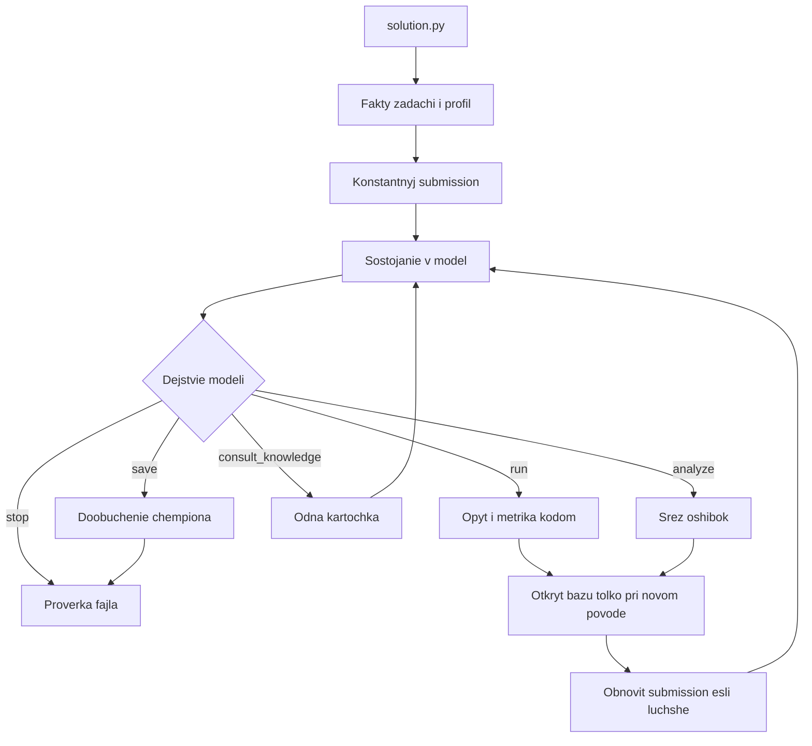

# Агент, который сам выбирает шаг

Модель решает, что делать дальше. Харнес не начинает с бустинга, не держит очередь моделей и не открывает базу знаний на каждом круге. Он умеет три вещи: достать факты, выполнить одно названное действие и не потерять `submission.csv`.

Этот файл можно читать без кода. В zip для платформы его нет: платформа забирает только корневые `.py` и выданный `requirements.txt`.

## Чем харнес отличается от политики

Харнес — это среда. Политика — это выбор модели на очередном шаге.

Среда делает всегда, потому что иначе платформа не примет решение:

- читает путь к `task.md` из аргумента;
- находит `train.csv`, `test.csv`, `data_dictionary.csv`, `sample_submission.csv` по путям из текста, а если их нет — поиском от каталога задачи, не предполагая корень;
- определяет `id`, цель и метрику по словарю, шаблону и тексту, без имён колонок конкретного датасета;
- до любого вызова модели пишет валидный `submission.csv` с константой (среднее или мода). Это не выбранная модель и не стартовый алгоритм. Это запасной файл на случай, если процесс убьют на первом запросе. Первое удачное обучение его заменяет;
- считает метрику кодом на валидации. Числу из ответа модели не верит;
- пишет файл атомарно и перед выходом проверяет имя, число строк, колонки, пустоты и допустимые метки;
- ошибка одного запроса к модели или одного опыта не завершает процесс без файла.

Среда не делает никогда:

- не назначает первую модель, вторую модель и «модель, если осталось время»;
- не открывает карточку базы только потому, что начался новый круг;
- не подменяет решение модели экспертным порядком LightGBM, CatBoost, линейная модель;
- не ставит пакеты и не ходит в интернет.

Список библиотек в промпте — это ящик инструментов, которые вообще можно запустить в контейнере. Порядок в ящике ничего не значит. Модель может начать с линейной модели, с нейросети на `torch`, с FLAML, с CatBoost или со среза ошибок. Неизвестное имя возвращается как ошибка инструмента, после чего модель выбирает снова.

## Время

Отдельной фазы «проверить, хватает ли времени, и поэтому перейти к финальному бустингу» нет. Такая проверка плохо выбирает алгоритм: дешёвый полезный опыт можно зря запретить, а дорогой, начатый слишком рано, она не ловит.

Остаются два факта, и это не политика:

- в состоянии для модели есть `elapsed_sec` и `remaining_sec`. Как ими распорядиться, решает модель: короткий опыт, сохранение, остановка;
- если у запрошенного `run` таймаут больше, чем живое время до конца, харнес не запускает его и возвращает текст ошибки. Модель на следующем шаге выбирает более короткое действие или `save` / `stop`. Это защита записи файла, а не выбор семейства моделей.

Обязательного резерва «последние 20 минут только дообучение» нет. Чемпион и так уже записан в `submission.csv` после каждого удачного опыта. `save` — отдельное действие модели: переобучить текущую лучшую спецификацию на всём train. Если модель его не попросит, на платформе останется последний честный файл.

Бюджет процесса — `AGENT_TIME_BUDGET_SEC`, на платформе это 10800 секунд. Часы стартуют в начале `solution.py`.

## Цикл



Один шаг — одно главное действие. Модель может приложить второе независимое действие с пометкой `parallel`. Харнес запускает их вместе, только если они не зависят друг от друга и помещаются в 8 ядер. Два обучения делят потоки. Срез ошибок по уже посчитанному журналу идёт рядом с обучением, потому что он почти не занимает CPU. Харнес не сам придумывает параллельный экран трёх бустингов.

Пара независимы, только если это два `run`, `run` и `analyze`, или два `analyze`. `save`, `stop` и `consult_knowledge` вторым действием не запускаются.

Пока идёт длинный `run`, новый запрос к модели не делается. Следующее решение опирается уже на результат, а не на догадку о нём.

Порог шума остаётся правилом записи чемпиона, не правилом выбора алгоритма. Опыт заменяет чемпиона, если метрика лучше с учётом разброса фолдов. Иначе опыт остаётся в журнале как отвергнутый, файл не переписывается. Модель видит оба исхода и сама решает, продолжать линию или сменить её.

Правило записи: первое удачное обучение становится чемпионом. Следующее заменяет его, если улучшение строгое. Когда фолдов больше одного и есть `val_std`, улучшение должно быть больше половины этого разброса. Ухудшение относительно чемпиона помечается как вред. Изменение внутри шума чемпиона не меняет и вредом не считается.

## Когда открывается база знаний

База — черновик. Сейчас в ней вперемешку табличные карточки и советы по нейросетям. Её будут расширять новыми доменами и статьями. Поэтому она не вшита в порядок шагов.

Харнес открывает базу сам, до вызова модели, и только по одному из поводов:

- модель на прошлом шаге попросила `consult_knowledge` и назвала вопрос;
- с прошлого открытия появился новый сигнал, и на него есть карточка, которую в этой задаче ещё не показывали;
- модель повторяет механизм, который уже помечен как вредный, и в базе есть карточка с таким `avoid_when`.

Если повода нет, поле знаний в состоянии пустое. В промпте прямо написано, что база в этот раз не открывалась. Модель может заниматься профилем и журналом.

Открытие не означает применение. Карточка попадает в контекст как совет. Решает модель. Одну и ту же карточку на одном и том же наборе сигналов второй раз не прикладывают.

Как выбирается карточка, когда повод есть:

- в память загружен только индекс: `id`, домен, одна строка, сигналы `applies_when` и `avoid_when`;
- полный текст читается у одной лучшей карточки;
- две соседние остаются в индексе заголовками, без текста;
- если сигналы ни на что не похожи, а модель задала вопрос словами, ищем пересечение слов с однострочными описаниями. Отдельных эмбеддингов нет: их нет в разрешённых пакетах, а черновик ещё маленький.

Совпадение по сигналам требует всех имён из `applies_when`. Любое имя из `avoid_when`, которое уже измерено, карточку исключает. При прочих равных побеждает более узкое условие, то есть более длинный `applies_when`. Пустой `applies_when` сам не всплывает: такую карточку можно достать только вопросом.

Сигнал — это имя факта, которое код умеет измерить. Карточка, чей сигнал код измерять не умеет, лежит в базе и не всплывает. Чтобы такой сигнал ожил, в реестр добавляется один детектор. Новая карточка на уже существующем сигнале кода не требует.

Сейчас детекторы такие:

- `labels_imbalanced` — доля меньшего класса ниже 5% или самый частый класс больше редкого в десять раз;
- `high_cardinality_categories` — у категориальной колонки 30 или больше уровней;
- `non_iid` — в имени колонки есть year, date, time, month, hour или timestamp;
- `rare_class_metric_noisy` — в классификации самый редкий класс меньше 100 строк;
- `too_many_features` — признаков 400 или больше;
- `split_is_random_only` — ещё не было удачного `run` со сплитом `group` или `time`;
- `metric_is_accuracy` — метрика accuracy и классы несбалансированы;
- `gap_persists` — у последнего удачного опыта train заметно лучше val, разрыв от 5%;
- `val_error_higher` — тот же разрыв от 2%;
- `train_error_high` — train не лучше константы или лучше меньше чем на 1%;
- `errors_not_sliced` — был удачный `run` и не было удачного `analyze`;
- `features_not_scaled` — чемпион линейный и среди его шагов нет `scale`.

`task_tabular`, `task_binary`, `task_multiclass`, `single_output` попадают в список сигналов, чтобы карточка могла на них сослаться, но сами по себе базу не открывают. Иначе каждая таблица начиналась бы с одной и той же карточки.

`protocol.yaml` текущего черновика описывает, как читать карточки, но не управляет агентом. Правило «каждый шаг открывай одну карточку» в цикл не переносится. Правило «при низкой уверенности спроси человека» на платформе некому задать: спорный опыт просто не становится чемпионом, пока метрика его не подтвердила.

Исходник базы остаётся в `main-base` рядом с репозиторием агента. Скрипт `dev/compile_knowledge.py` превращает её в `knowledge_data.py`, потому что платформа не копирует yaml. Новый домен — новый yaml той же схемы и повторная сборка.

Схема карточки, которую нельзя ломать при расширении:

- `id`, `domain`, `summary` в одну строку;
- `applies_when`, `avoid_when` — имена сигналов, список может быть пустым;
- `mechanism` — короткий текст, зачем приём;
- `try` — значения, которые имеет смысл пробовать, не приказ их пробовать;
- `expect_if_helps`, `expect_if_hurts`;
- `sources`.

## Что модель может попросить исполнить

Спецификация `run` собирается моделью. Харнес её не дописывает «правильными» гиперпараметрами.

- `estimator`: имя из ящика. Сейчас ящик такой: `linear`, `lightgbm`, `catboost`, `xgboost`, `torch_mlp`, `flaml`, `lightautoml`. AutoGluon в ящик не входит: без интернета он часто пытается скачать веса. Если модель просит его, инструмент возвращает отказ, и модель выбирает другое;
- `params`: словарь, который оценщик понимает. Пустой словарь значит штатные значения библиотеки, не наши экспертные;
- `features`: список шагов, которые код умеет сделать безопасно. Модель выбирает, какие включить: индикатор пропуска, log1p числовых хвостов, sin/cos для градусов, частоты категорий, OOF target encoding, агрегаты по названной колонке группы, отношение двух названных колонок, log1p цели с обратным преобразованием. Шаг, который подглядывает в test или учит кодировку цели на всей выборке, отклоняется до запуска;
- `code`: необязательный короткий `transform(train, test)`. Не больше трёх таких опытов за задачу. AST запрещает файлы, сеть и процессы. Таймаут и один ремонт по тексту ошибки. Провал хоронит этот код и возвращает модель к выбору;
- `split`: `kfold`, `stratified`, `group` с именем колонки или `time` с именем колонки. Колонка должна существовать. Препроцессинг учится внутри фолда;
- `fidelity`: доля строк или один holdout против полных фолдов. Это тоже выбор модели. Харнес не переводит сам «сначала дёшево, потом дорого»;
- `timeout_sec`: сколько модель готова ждать этот опыт.

Если в `run` нет обязательного поля, инструмент возвращает ошибку и ничего не обучает. Обязательны `estimator` из ящика, `split.name`, для `group` и `time` ещё `split.column`, `fidelity.mode` (`holdout` или `cv`), для holdout — `fraction` от 0.05 до 0.5, для cv — `folds` от 2 до 10, и положительный `timeout_sec`. `flaml` и `lightautoml` принимаются только с `fidelity.mode=holdout`.

`analyze` считает то, что модель назвала: метрику по уровням категории, ошибку по квантилям предсказания, F1 по классам, связь пропуска с ошибкой. Сырой датафрейм в промпт не кладётся, только сводка.

`save` переобучает чемпиона на всём train и заново пишет файл. Своей спецификации у `save` нет: берётся спецификация текущего чемпиона. Если чемпиона ещё нет или до конца меньше 30 секунд, действие возвращается как отказ.

`stop` выходит в проверку файла.

## Состояние, которое видит модель

Каждый вызов получает один JSON и ничего лишнего.

- краткое условие и дословный фрагмент про метрику и формат файла;
- имена `id` и цели, тип задачи, направление метрики;
- профиль фактов: размеры, доли пропусков, кардинальности, перекос или частоты классов, кандидаты группы и времени. В профиле нет фразы «поэтому возьми бустинг»;
- журнал: что просили, что получилось по метрике, взяли ли в чемпионы, короткая ошибка, если была;
- чемпион: метрика и краткая спецификация, без дампа весов;
- время: прошло и осталось;
- знания: `null` либо причина открытия, полный текст одной карточки и заголовки двух соседних;
- последний отказ инструмента, если он был;
- `toolbox`: имена и короткие возможности оценщиков;
- `contracts`: форма `split`, `fidelity` и шагов признаков, чтобы пустая спецификация не была единственным способом узнать контракт.

В промпт не попадают ключ, сырые строки и полный текст базы.

## Промпт решения

Этот текст и есть системный промпт. Отдельного промпта «выбери карточку» нет: карточку выбирает харнес и уже кладёт её в состояние.

```text
Ты ведёшь одну ML-задачу до файла submission.csv. Харнес не выбирает модель и не задаёт порядок алгоритмов. На каждом шаге ты видишь факты и сам называешь одно следующее действие.

Доступные действия:
- run — обучить и оценить спецификацию. Качество посчитает код на валидации.
- analyze — посчитать срез ошибок текущего чемпиона. Ты называешь срез, код считает.
- consult_knowledge — попросить одну карточку из базы. Проси, только когда для следующего приёма не хватает знания. Если карточка уже лежит в состоянии, не проси её снова.
- save — обучить текущую лучшую спецификацию на всём train и обновить submission.csv.
- stop — остановиться, если следующий опыт не стоит оставшегося времени.

Имена оценщиков, которые среда умеет запустить, перечислены в состоянии в поле toolbox. Это возможности, а не последовательность. Пустые params означают штатные значения библиотеки.

Правила ответа:
- Одно основное действие. Второе добавляй только в parallel и только если оно не зависит от результата первого.
- Не повторяй спецификацию, которая уже есть в журнале.
- Не используй test для выбора.
- Не записывай качество числом, которого нет в журнале.
- Если timeout_sec больше remaining_sec, это действие не запустится. Сразу выбери более короткое, save или stop.
- Ответ — один JSON без текста вокруг.

Форма:
{
  "why": "одно-два предложения",
  "action": "run | analyze | consult_knowledge | save | stop",
  "spec": {},
  "parallel": null
}

Для run в spec поля: estimator, params, features, code, split, fidelity, timeout_sec.
Для analyze в spec поле slice: by_category | by_quantile | per_class | missing_vs_error и необязательное column.
Для consult_knowledge в spec поле question: какие сигналы или какой вопрос.
Для save и stop spec может быть пустым.
parallel — либо null, либо такой же объект action/spec.
```

Пользовательское сообщение — это JSON состояния и одна строка: «Выбери следующее действие». Если поле знаний пустое, перед JSON есть строка «База знаний в этот раз не открывалась.»

Если JSON пустой, оборван или у ответа нет `choices`, харнес делает до трёх повторов внутри одного запроса. После неудачи шаг пропускается, в журнал пишется ошибка модели, запасной файл остаётся на месте, цикл пробует ещё раз, пока не кончится время процесса. Подменной моделью «на всякий случай LightGBM» харнес не обучает.

Шесть отказов или пустых ответов подряд останавливают цикл. Это защита бюджета, не выбор алгоритма. Между сбоями самого запроса к модели пауза растёт как `min(30, 2^n)` секунд. Отказ инструмента эту паузу не включает: модель сразу видит текст ошибки.

## Промпт ремонта кода

Нужен только если модель прислала `code` и он упал. Один раз.

```text
Код transform(train, test) упал. Верни только исправленную функцию.
Не добавляй импорты вне pandas и numpy. Не читай файлы и не обращайся к сети.
Не используй целевую колонку как признак. Ответ — тело функции, без пояснений.

Ошибка:
{stderr}

Код:
{code}
```

Второй провал этого кода больше не чинится.

## Как устроено расширение базы

Человек, который дополнит черновик, делает так:

- кладёт карточки нового домена в yaml с полями схемы;
- если все `applies_when` уже измеряются, запускает сборку индекса: `python dev/compile_knowledge.py`;
- если нужен новый факт, добавляет детектор с тем же именем сигнала в `detect_signals` и имя в `TRIGGER_SIGNALS`, и только потом ждёт, что карточка начнёт открываться;
- не пишет в карточки порядок «сначала сделай бустинг»: у карточки нет власти над циклом, пока харнес её не открыл, а после открытия это совет.

Индекс растёт линейно от числа карточек. В промпт по-прежнему попадает одна. Поэтому расширение базы не раздувает каждый запрос к модели.

## Журнал и логи

Локальный прогон пишет `agents/<версия>/runs/<дата-время>_<задача>/events.jsonl`: состояние без секретов, действие модели, открывали ли базу и почему, метрику до и после, взяли ли чемпиона, отказ инструмента. По этому файлу видно, где модель принимает слабое решение, а где харнес зря открыл или не открыл базу. На платформе тот же журнал лежит в каталоге `agent_run` рядом с `task.md`, если не задан `AGENT_RUN_DIR`. В stdout короткие имена шагов.

Ключ API в журнал не пишется. Рядом с журналом хранится последняя проверенная копия `submission.csv`. Если финальная проверка не сходится, файл восстанавливается из этой копии.

## Сдача и локальная проверка

Платформа: `python solution.py path/to/task.md`, 8 CPU, 32 GB, 3 часа, переменные `OPENAI_BASE_URL`, `OPENAI_API_KEY`, `OPENAI_MODEL`. Локально рабочий шлюз — `https://api.alfahack-gateway26.ru/v1`, модель `qwen/qwen3.8-27b`. Ключ берётся из окружения, в архив не кладётся. `baseline.py` не используем: он импортирует `mcp`, которого нет в requirements.

`solution.py` в начале добавляет свой каталог в `PYTHONPATH` и `sys.path`. Дочерний процесс обучения стартует через `spawn` и импортирует те же плоские модули.

Репозиторий: `agents/<время создания>/`. Модули в корне, без вложенных пакетов:

- `solution.py` — аргумент, сигналы остановки, вызов цикла, проверка файла на выходе;
- `harness.py` — состояние, журнал, чемпион, параллель, ремонт кода, запись файла;
- `task_io.py` — `task.md`, пути, метрика, константа, атомарная запись и проверка;
- `profile_data.py` — факты без рекомендации алгоритма;
- `knowledge_data.py` — собранный индекс карточек;
- `knowledge.py` — детекторы и правило, открывать ли одну карточку;
- `research.py` — оба промпта и разбор JSON;
- `llm_client.py` — клиент шлюза;
- `toolbox.py` — ящик оценщиков и срезы ошибок.

Скрипты сборки базы, локального запуска и zip лежат в `dev/` и в архив не входят. Документ пайплайна — этот файл.

Локально:

```bash
python dev/compile_knowledge.py
python dev/check_io.py
python dev/run_local.py --task /путь/к/task.md --budget 900
python dev/make_zip.py
```

`run_local.py` читает `API_KEY` из `.env` рабочего каталога хакатона, кладёт его в `OPENAI_API_KEY` и не печатает. Задача копируется в `runs/<время>_<имя>/task` симлинками на csv, чтобы `submission.csv` не появлялся в исходной папке.

Проверка до zip:

- разбор обеих публичных задач и копии, где csv лежат не рядом с `task.md`, а по относительному пути;
- константный файл проходит проверку колонок и числа строк ещё до модели;
- короткий живой прогон на одной задаче: модель сама называет действие, журнал показывает, открылась ли база, файл после удачного `run` обновляется;
- полный трёхчасовой прогон обеих задач в этот заход не запускается.

Критерий архива: меньше 100 МБ, в корне нет yaml и пакетов, при обрыве модели файл предсказаний валиден, в коде нет ветки «если таблица, начни с бустинга».

## Контракты, которые не являются выбором модели

Это среда, а не порядок алгоритмов.

- Зерно везде 0: сплит, подвыборка, `random_state` / `random_seed`, если модель сама его не задала.
- Потоки одного опыта ограничены долей от 8 ядер. Перед `spawn` выставляются `OMP_NUM_THREADS`, `OPENBLAS_NUM_THREADS`, `MKL_NUM_THREADS`, `NUMEXPR_NUM_THREADS`, затем окружение родителя возвращается.
- CatBoost всегда запускается с `allow_writing_files=False`.
- Пустые `params` у `torch_mlp` значат hidden=64, epochs=5, lr=0.001, batch=256. Это описание инструмента в состоянии, не указание начать с сети.
- У `flaml` и `lightautoml` бюджет времени равен `timeout_sec` минус небольшой запас, но не меньше 5 секунд, и только holdout.
- Пропуски и категории — водопровод оценщика, а не выбранный шаг признаков. Линейная модель: медиана и one-hot до 100 уровней, иначе порядковый код. LightGBM получает категории как categorical. CatBoost получает строки. XGBoost, torch и FLAML получают порядковый код и медиану. `scale` применяется только если модель назвала этот шаг. `log_target` тоже только по запросу и только если цель неотрицательна; обратное преобразование делается до метрики.
- Шаги признаков учатся на обучающей части фолда и применяются к валидации и к test. Кодировка цели на всей выборке и чтение test при обучении шага отклоняются.
- Отпечаток опыта — оценщик, параметры, шаги, код, сплит и fidelity. Повтор этого отпечатка не запускается. Таймаут в отпечаток не входит.
- Механизм — это оценщик, имена шагов и наличие кода. Если такой механизм уже вредил, другой набор параметров всё ещё можно запустить. На следующем шаге харнес может открыть карточку с подходящим `avoid_when`.
- Считаются `rmse`, `mae`, `rmsle`, `mape`, `r2`, `f1_macro`, `f1_weighted`, `f1_micro`, `accuracy`. Для `logloss`, `roc_auc` и `pr_auc` инструмент возвращает отказ: вероятности он не хранит.
- `SIGTERM` и `SIGINT` ставят флаг остановки. Текущий опыт прерывается, проверка файла всё равно выполняется.
- Если переменных `OPENAI_*` нет, цикл модели не начинается, константный файл остаётся.
